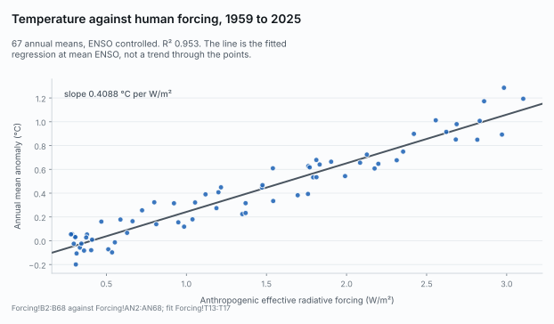

# Climate Change Analysis 2

Global surface temperature regressed on CO<sub>2</sub> and on anthropogenic
effective radiative forcing, with solar, ENSO and volcanic variability controlled
for. 822 months, March 1958 to August 2026, in a 22-sheet Excel workbook with
reproduction scripts for every pasted figure.

The point of this repository is not the result, which is unremarkable and agrees
with the published literature. It is that you can check the result without
trusting the author.

**[Read the summary page →](https://russnida-repo.github.io/Climate_Change_Workbook/)**

<picture>
  <source srcset="docs/figures/fig2-forcing-fit-dark.svg" media="(prefers-color-scheme: dark)">
  
</picture>

## The result

Annual mean anomaly on anthropogenic ERF with ENSO controlled, 1959 to 2025,
scaled by F<sub>2×</sub> = 3.93 W/m²:

**1.607 °C per CO<sub>2</sub> doubling**, 1.43 to 1.78 at 90% once forcing
uncertainty is propagated.

> **This is not TCR.** It is a historical regression on a single 66-year
> realisation, scaled by F<sub>2×</sub>. The transient climate response is defined
> by a 1%-per-year model experiment, which this is not. The number falls inside
> the IPCC AR6 range, and that is a comparison, not a validation.

What the analysis does and does not support is set out on `Summary` rows 26 to 31,
and the limits are stated there rather than here.

## Check it yourself

This is the part that matters. Four scripts reconstruct the workbook's pasted
figures from the same public inputs; two of them compare themselves against the
workbook cell by cell.

```bash
sha256sum -c MANIFEST.sha256

python3 residual_diagnostics.py
python3 validate_kernels.py
python3 erf_uncertainty.py Climate_Change_Analysis_2.xlsx erf_inputs 20000
python3 open_items.py Climate_Change_Analysis_2.xlsx roni_v5_cpc.csv
```

Requires Python 3.13, numpy, scipy and openpyxl. The exact versions behind the
reported runs are in `HANDOFF.md`.

**A clean run of `validate_kernels.py` reports exactly one `DIFFERS`**, at
`Kernel!P69`, the CO<sub>2</sub>-only pooled R² whose 0.006 gap has no recoverable
provenance. The script is deliberately written to report it rather than reconcile
it. Any other `DIFFERS` is a finding. `erf_uncertainty.py` should report none.

`residual_diagnostics.py` and `open_items.py` do not self-check. They print their
results beside the workbook baselines and leave the comparison to you, so a silent
run from those two means nothing was compared rather than that everything matched.

To re-verify the ENSO input specifically, including the rounding convention and
how far the operational CPC series differs from the one used here:

```bash
python3 verify_roni_ingest.py
```

To redraw the summary-page figures from the workbook:

```bash
python3 make_figures.py Climate_Change_Analysis_2.xlsx docs/figures
```

## What is here

| | |
|---|---|
| `Climate_Change_Analysis_2.xlsx` | the workbook, 22 sheets, 120,565 computed cells |
| `Climate_Change_Analysis_2.md` | full Markdown export: every cell and every formula |
| `Climate_Change_Analysis_2_audit.md` | audit extract: formulas and panels, no bulk data |
| `HANDOFF.md` | **read this before changing anything** |
| `MANIFEST.sha256` | checksums for the package |
| `residual_diagnostics.py` | the `Diagnostics` tab |
| `validate_kernels.py` | the `Kernel` tab and its blocked cross-validation |
| `erf_uncertainty.py` | the `Sensitivity` tab and its Monte Carlo |
| `open_items.py` | the `Open Items` tab |
| `convert_to_md.py` | produces both Markdown exports |
| `make_figures.py` | redraws the summary-page figures |
| `verify_roni_ingest.py`, `map_roni_rows.py`, `roni_quantisation_test.py` | the ENSO-input checks |
| `erf_inputs/`, `roni_v5_cpc.csv`, `RONI.v5.ascii.txt` | the inputs not derived inside the workbook |
| `EXPECTED_v17*.md` | acceptance tests each release was checked against |
| `docs/` | the summary page and its figures |

The Markdown exports exist so the workbook is reviewable as text. A spreadsheet
diff is unreadable; `Climate_Change_Analysis_2.md` is not.

## Known open items

Left open deliberately, and stated rather than buried. `HANDOFF.md` has the full
reasoning for each.

- `Kernel!P69` differs from its script by 0.006 with no recoverable provenance.
- Substituting RONI for ONI as the ENSO control makes the fit worse, so it is
  carried as a structural uncertainty of +0.058 rather than adopted.
- The aerosol contribution is identified; the aerosol response per W/m² is not,
  because the series magnitude is itself uncertain by a factor of four.
- The 2023 to 2025 residual, about +0.16 °C, is unexplained. The leading
  candidate, the CERES shortwave decline, was tested and does not work: it would
  imply roughly eight times the warming it is meant to account for.

## A note on the two engines

Through v1.7.2 seven formulas in `Diagnostics` passed a lone boolean array to
`SUMPRODUCT`. LibreOffice coerces that to numbers; Excel returns 0. Eighteen cells
dividing by those seven showed `#DIV/0!` to every Excel user from v1.1 onward,
while the pasted figures, every script and every export stayed numerically right.
It survived three adversarial reviews, because each one checked LibreOffice output
against LibreOffice-derived material.

It is fixed, and the two engines now agree across all 120,565 computed cells. The
habit it should leave behind: a figure confirmed by one engine is unconfirmed.

## Licence

| | |
|---|---|
| The scripts | MIT, see `LICENSE` |
| The workbook, its notes and the Markdown exports | CC BY 4.0, see `LICENSE-CONTENT.md` |
| The input datasets | their own terms, recorded in the `Sources` tab |

Most inputs are United States Government work in the public domain. **Four
attributions survive onward reuse** and are not discharged by reusing this
repository: the ClimateIndicator forcing-timeseries repository is MIT and requires
its copyright and permission notices to travel with any copy (see
`THIRD-PARTY-NOTICES`), HadCRUT5 carries the Open Government Licence v3, and
Berkeley Earth is CC BY 4.0.

## Citation

> Nida, R. (2026). *Climate_Change_Analysis_2*: global temperature against
> CO<sub>2</sub> with natural-variability controls. Version 1.7.11. CC BY 4.0.
